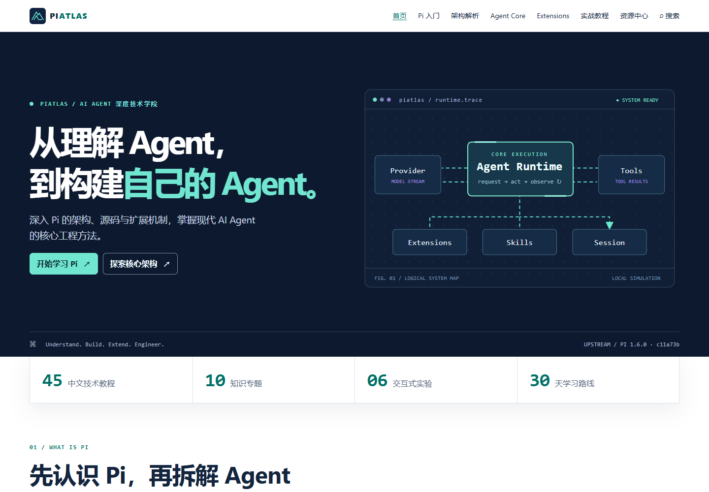
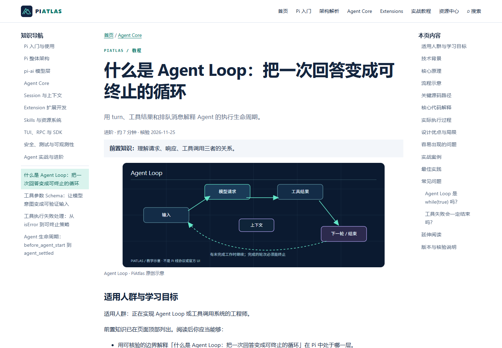
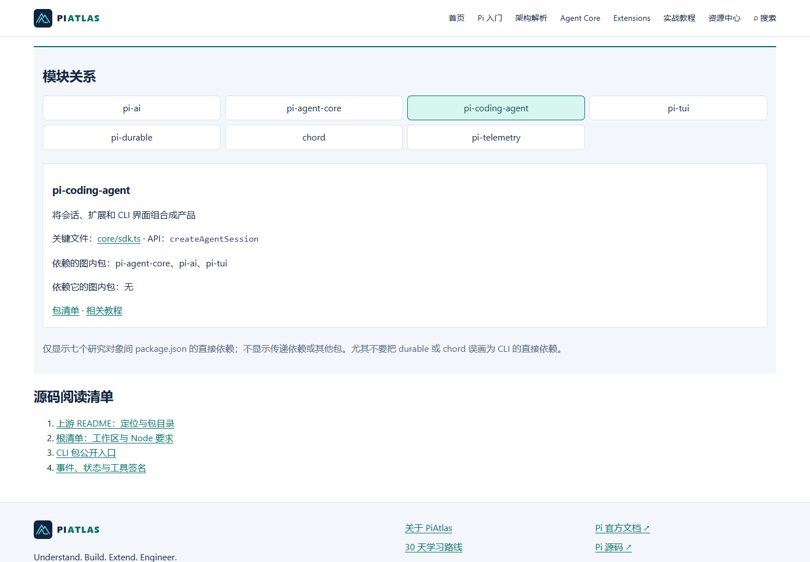
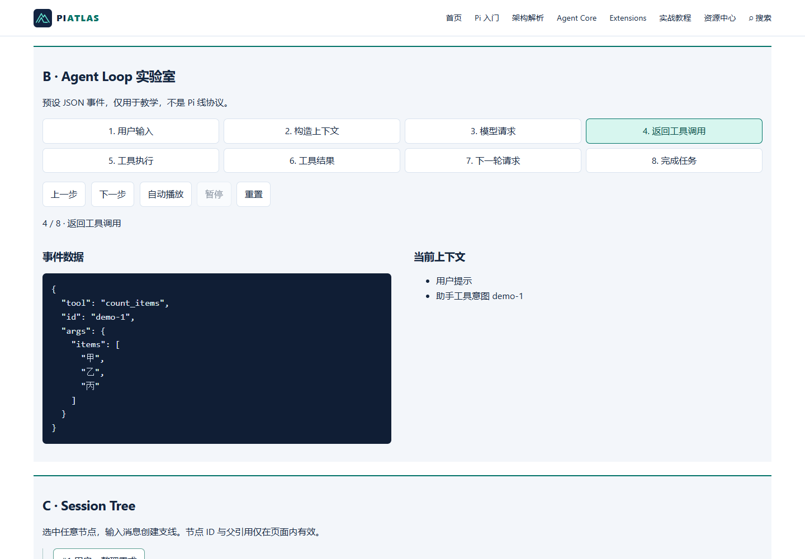
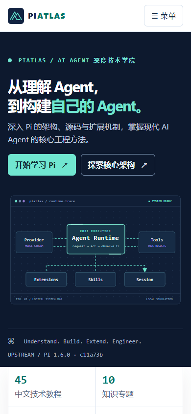

# PiAtlas - AI Agent 深度技术学院

PiAtlas 是一个面向中文开发者的 Pi Agent 技术知识网站。它不是官方 README 的翻译，也不是展示型模板，而是一个以固定源码快照为基础、把“官方说明 / 源码观察 / 工程分析 / 教学模拟”明确分开的长期维护型知识平台。

- 项目名称：PiAtlas
- 中文名称：PiAtlas - AI Agent 深度技术学院
- 研究对象：[earendil-works/pi](https://github.com/earendil-works/pi)
- 官方文档：[docs.pi.dev](https://docs.pi.dev/)
- 线上地址：[https://yuxinrun.github.io/piatlas/](https://yuxinrun.github.io/piatlas/)
- 品牌标语：Understand. Build. Extend. Engineer.
- 中文标语：从理解 Agent，到构建自己的 Agent。

---

## 一、项目定位

PiAtlas 面向 AI Agent 初学者、TypeScript / Node.js 开发者、Coding Agent 开发者、Agent Runtime 工程师以及希望基于 Pi 构建产品的架构师。

网站试图回答六个问题：

1. Pi 是什么，它与普通聊天机器人有什么本质区别？
2. 如何安装、配置并安全地使用 Pi？
3. Pi Monorepo 中各包的职责与边界是什么？
4. 统一 LLM API、Provider 适配、Agent Loop、Tool Calling 如何协作？
5. Session、Branch、Context Compaction 如何支撑长任务？
6. 如何开发 Extension、Skill、RPC 服务、SDK 集成和自己的 Agent？

核心理念：**Understand. Build. Extend. Engineer.**

---

## 二、技术栈

- Vite：开发服务器与静态构建
- TypeScript：搜索、实验室、学习进度等前端逻辑
- 原生 HTML / CSS：页面结构与全部视觉系统
- Markdown + markdown-it：文章内容数据源
- highlight.js：代码高亮
- 原生 SVG：Hero、15 张知识图和架构示意
- GitHub Actions + GitHub Pages：自动部署

项目不使用 React、Next.js、数据库、后端 API、用户登录或大型 UI 框架。所有页面都构建为纯静态文件。

---

## 三、功能列表

### 内容系统

- 45 篇中文技术文章，覆盖十大知识体系。
- 每篇文章包含摘要、难度、前置知识、阅读时间、目录、代码复制、源码路径、版本与核验日期。
- 文章按十大板块组织，并提供上一篇 / 下一篇与相关教程。
- 固定上游 commit：`c11a73bfba1310dc4075ad836254ea87003f409b`。
- 研究笔记：[`docs/research/RESEARCH.md`](docs/research/RESEARCH.md)。

### 页面与路由

- 首页、快速入门、架构解析、模型层、Agent Core、Session、Extension、Skills、TUI、集成、安全、遥测、实战、30 天路线、源码地图、实验室、全部文章、文章详情、关于、搜索、404。
- GitHub Pages 子目录部署使用 `/piatlas/` base。
- 静态目录预生成，刷新子路由不依赖服务端 rewrite。

### 六大交互功能

- A · Pi 架构地图：点击模块查看职责、源码入口、API 与图内直接依赖。
- B · Agent Loop 实验室：单步 / 上一步 / 自动播放 / 暂停 / 重置，展示事件与上下文。
- C · Session Tree：切换节点、创建本地分支、查看祖先链。
- D · Context Compaction：用模拟预算观察摘要替换与原文保留。
- E · Extension 开发练习：真实 API 片段与教学模拟并列展示，支持复制。
- F · 架构比较：按维度筛选 Pi、Codex CLI 与 OpenAI Agents SDK 的结构差异。

### 全站搜索

- 构建时生成本地 `search-index.json`。
- 支持标题、摘要、正文、分类、技术术语和源码路径检索。
- 支持高亮、搜索建议、快捷键 `/`、空结果提示和移动端输入。

### 学习路线

- 30 天、九阶段学习中心。
- 每天包含主题、内容、推荐文章、实践任务与验收标准。
- 完成状态保存在浏览器 `localStorage`，无需注册。

### SEO 与可访问性

- 独立 title、description、canonical、Open Graph。
- `sitemap.xml`、`robots.txt`、`favicon.svg`。
- TechArticle 与 BreadcrumbList 结构化数据。
- 语义化 HTML、skip link、键盘焦点样式、ARIA 状态、`prefers-reduced-motion`。

---

## 四、网站截图

以下截图均来自本地实际运行的网站，使用 Playwright 在真实浏览器中截取，不是设计稿或伪造图片。

### 桌面首页



### 文章详情页



### 架构地图



### Agent Loop 实验室



### 手机端首页



---

## 五、目录结构

```text
piatlas/
├── .github/
│   └── workflows/
│       └── deploy.yml          # GitHub Pages 自动部署
├── docs/
│   ├── research/
│   │   └── RESEARCH.md         # 固定快照研究笔记与事实账本
│   └── screenshots/            # 真实浏览器截图
├── public/
│   ├── favicon.svg
│   └── hero.svg                # 首页原创 Hero 视觉
├── scripts/
│   ├── generate.mjs            # 文章、页面、SVG、索引生成
│   └── check.mjs               # 本地链接与文章数量校验
├── src/
│   ├── articles/               # 45 篇 Markdown 文章
│   │   ├── getting-started/
│   │   ├── architecture/
│   │   ├── pi-ai/
│   │   ├── agent-core/
│   │   ├── sessions/
│   │   ├── extensions/
│   │   ├── skills/
│   │   ├── tui/
│   │   ├── security/
│   │   └── projects/
│   ├── data/
│   │   ├── catalog.mjs         # 站点、模块、图表、事件、版本
│   │   ├── roadmap.mjs         # 30 天路线数据
│   │   └── examples.mjs        # 扩展与代码示例
│   ├── tools/
│   │   ├── search.ts
│   │   └── labs.ts
│   ├── site.ts                 # 全站交互入口
│   └── styles.css              # 设计系统与响应式布局
├── package.json
├── tsconfig.json
├── vite.config.ts
├── LICENSE
└── README.md
```

运行时生成目录：

- `.generated/`：由 `scripts/generate.mjs` 生成，包含全部静态 HTML、SVG、下载文件、搜索索引、sitemap 等。
- `dist/`：Vite 构建产物，可直接部署。

二者都不应手工编辑，也不建议提交到 Git。

---

## 六、本地开发

### 环境要求

- Node.js 22.19 或更高版本（与上游 Pi 要求保持一致）。
- npm。

### 安装依赖

```bash
npm install
```

CI 使用：

```bash
npm ci --ignore-scripts
```

### 本地运行

```bash
npm run dev
```

开发服务器地址通常为：

```text
http://localhost:5173/piatlas/
```

`dev` 脚本会先运行生成器，再启动 Vite，因此新增文章后无需手工重建索引。

### 构建

```bash
npm run build
```

构建流程：

1. `tsc --noEmit` 检查 TypeScript。
2. `node scripts/generate.mjs` 生成页面、SVG、搜索索引与 sitemap。
3. `vite build` 构建静态资源到 `dist/`。
4. `node scripts/check.mjs` 校验 HTML 数量与本地链接。

### 预览构建产物

```bash
npm run preview
```

默认访问：

```text
http://localhost:4173/piatlas/
```

---

## 七、GitHub Pages 部署

仓库：`yuxinrun/piatlas`

工作流文件：`.github/workflows/deploy.yml`

部署步骤：

1. 在 GitHub 仓库设置中，将 Pages 的 Source 设为 **GitHub Actions**。
2. 保持 `vite.config.ts` 中 `base: '/piatlas/'`。
3. 推送到 `main` 分支（或在 Actions 页面手动触发 `workflow_dispatch`）。
4. 工作流执行 `npm ci --ignore-scripts`、`npm run build`。
5. 使用 `actions/configure-pages@v5`、`actions/upload-pages-artifact@v3` 和 `actions/deploy-pages@v4` 发布 `dist/`。

工作流已配置：

- `contents: read`
- `pages: write`
- `id-token: write`
- `concurrency.group: github-pages`
- `cancel-in-progress: false`

最终访问地址：

```text
https://yuxinrun.github.io/piatlas/
```

静态页面直接放在 `dist/articles/<slug>/index.html` 等目录中，因此刷新子路由不会出现依赖 SPA fallback 的 404。`404.html` 提供未知路径兜底。

---

## 八、文章编写方法

### 1. 创建 Markdown 文件

路径格式：

```text
src/articles/<分类目录>/<slug>.md
```

例如：

```text
src/articles/agent-core/my-topic.md
```

### 2. 首行元数据

生成器要求第一行使用 `|` 分隔七个字段：

```text
标题|摘要|官方文档或源码路径|源码路径逗号列表|SVG ID|难度|前置知识
```

示例：

```text
Agent Loop 实战说明|用可重放事件解释循环边界|packages/coding-agent/docs/how-pi-works.md|packages/agent/src/agent-loop.ts,packages/agent/src/types.ts|loop|进阶|能阅读 TypeScript 基础类型
```

字段说明：

- `标题`：文章 H1 与搜索标题。
- `摘要`：列表页、OG description 和搜索摘要。
- `文档字段`：可写官方 docs 文件名（如 `sdk`），也可写固定 commit 下的仓库路径（如 `packages/ai/src/types.ts`）。
- `源码路径列表`：逗号分隔，指向固定 commit。
- `SVG ID`：必须是 `src/data/catalog.mjs` 中 `diagrams` 的 ID。
- `难度`：入门 / 进阶 / 高级。
- `前置知识`：一句话说明。

### 3. 正文建议结构

至少覆盖：

- 适用人群与学习目标
- 技术背景
- 核心原理
- 流程示意
- 关键源码路径
- 核心代码解释
- 实际执行过程
- 设计优点与局限
- 容易出现的问题
- 实战案例
- 最佳实践
- 常见问题
- 延伸阅读
- 版本与核验说明

文末的“版本与来源”由生成器统一追加。

### 4. 写作规则

- 官方事实必须能指向固定快照中的文档或源码。
- 源码观察只描述可见导出、字段和依赖声明。
- 作者分析使用“工程上可以理解为”“建议”等措辞。
- 教学模拟必须明确标注“不是 Pi API / 不是线协议”。
- 不虚构类名、函数名、参数或文件路径。
- 图片使用本地资源；文章内可用 `@site/diagrams/xxx.svg` 引用生成图。

---

## 九、添加 SVG 的方法

1. 在 `src/data/catalog.mjs` 的 `diagrams` 数组中加入新条目：

   ```js
   ['my-diagram','我的示意图',['节点一','节点二','节点三','节点四']]
   ```

2. 在 `scripts/generate.mjs` 的 `diagramBody(id, n)` 中为新 ID 增加一个布局分支。当前 15 张图各自有独立布局，不使用统一模板。
3. 文章的元数据第五个字段填写 `my-diagram`。
4. 运行 `npm run build`，确认生成 `dist/diagrams/my-diagram.svg` 且链接校验通过。

首页 Hero 由 `public/hero.svg` 独立维护，不复用知识图模板。

---

## 十、新增分类的方法

1. 在 `src/data/catalog.mjs` 的 `groups` 数组中加入新分类：

   ```js
   ['new-category','新分类名称','一句话说明']
   ```

2. 创建 `src/articles/new-category/` 目录并添加文章。
3. 如果该分类需要专属导航或页面说明，可在 `scripts/generate.mjs` 的相应 `page(...)` 配置中补充。
4. 更新 `src/data/roadmap.mjs`（若纳入 30 天路线）。
5. 运行 `npm run build`。

---

## 十一、新增交互功能的方法

1. 在 `src/tools/` 下新建 TypeScript 模块，导出初始化函数。
2. 在生成页面时加入所需 DOM 容器与 `data-page` 标记。
3. 在 `src/site.ts` 中按页面类型动态导入：

   ```ts
   if (page === 'my-page') void import('./tools/my-tool').then(m => m.initMyTool(base));
   ```

4. 保持交互完全本地化：不调用外部搜索 API、不上传用户输入、不执行真实工具。
5. 使用 `role="status"`、`aria-pressed`、`aria-current` 等属性保证可访问性。
6. 运行 `npm run build` 并用浏览器验证控制台无致命错误。

---

## 十二、内容来源与版本维护

### 事实来源优先级

1. 固定 commit 的官方 README 与 `packages/coding-agent/docs/*.md`。
2. 固定 commit 的源码、package.json 与 TypeScript 类型定义。
3. 官方文档站 `docs.pi.dev`（滚动更新，需谨慎引用）。
4. PiAtlas 作者的工程分析与建议（明确标注）。
5. 教学模拟（明确标注，不冒充官方 API）。

### 当前快照

- Pi 包版本：1.6.0（来自快照 package.json，不代表最新发布）
- commit：`c11a73bfba1310dc4075ad836254ea87003f409b`
- 核验日期：2026-11-25
- 研究笔记：`docs/research/RESEARCH.md`

### 升级检查清单

- 七个包的 package.json 中版本与直接依赖是否变化。
- `packages/ai/src/types.ts` 中事件与消息字段是否变化。
- `packages/agent/src/types.ts` 中工具与状态签名是否变化。
- `extensions.md` 中事件名与 API 是否变化。
- `sdk.md` 中会话生命周期是否变化。
- CLI flags 与 RPC 字段是否变化。

更新版本时请同步修改 `src/data/catalog.mjs` 中的 `revision` 与 `date`，并重新核验文章中的结论。

---

## 十三、已知限制

- print / JSON 模式的具体 CLI flags 未在已核验页面中确认，因此教程只讲语义，不杜撰参数。
- Context Compaction 实验室按字符模拟预算，不是真实 tokenizer。
- 架构地图只显示七个研究对象之间的直接依赖，不是完整依赖图或运行时调用图。
- 架构比较中的外部项目文档会滚动更新，结论仅作结构对照，不构成性能或优劣判断。
- sub-agent、plan mode 不是 Pi 内置能力，相关专题是扩展 / 宿主设计方案。
- 本网站不是 Pi 官方文档，也不隶属于 earendil-works。

---

## 十四、版权与免责声明

本站源码与原创内容采用 MIT License，详见 [`LICENSE`](LICENSE)。

Pi 的商标、名称与文档版权归其各自权利人所有。PiAtlas 引用的源码路径与文档链接仅用于技术研究和教学，不代表官方背书。

使用 Pi 或任何 Coding Agent 时，请自行评估文件系统、进程、网络与凭据风险；在隔离环境中运行未知扩展、Skill 或脚本。

---

## 十五、快速命令速查

```bash
npm install          # 安装依赖
npm run dev          # 本地开发
npm run build        # 构建 + 校验
npm run preview      # 预览 dist
```

访问：

- 本地：`http://localhost:5173/piatlas/`
- 线上：`https://yuxinrun.github.io/piatlas/`
